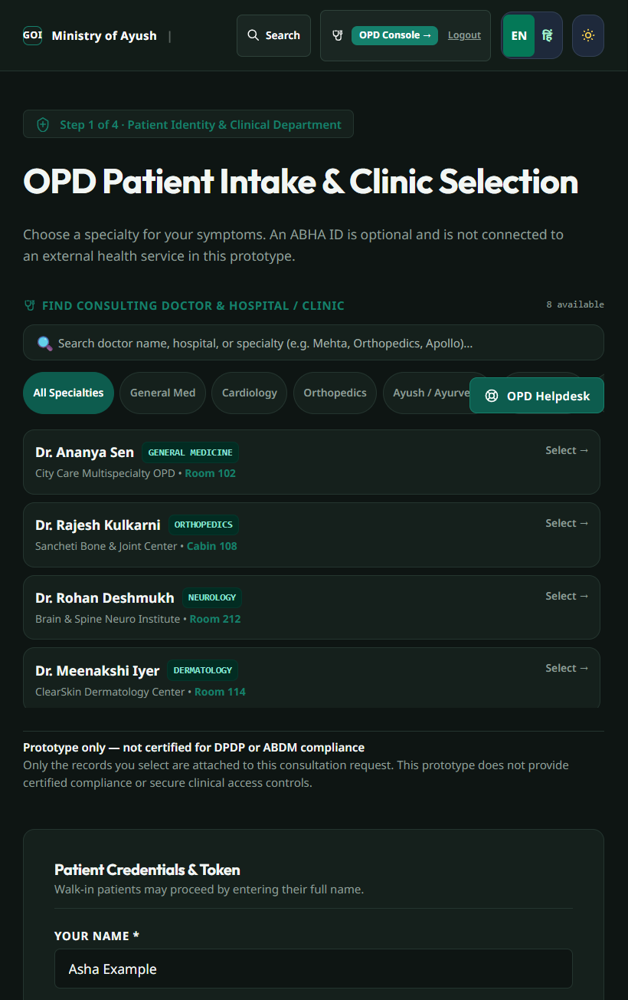

# MediKiosk

MediKiosk is a Smart India Hackathon prototype for multispecialty outpatient intake. Patients can choose a doctor or clinic, complete a structured nine-stage intake, choose records to share, and submit a consultation request. Doctors can review the queue and the information shared with them.

> **Prototype only. Do not enter real patient data or use this software to provide clinical care.** This project is not certified for ABDM, DPDP, or clinical use. Its authentication and authorization are not production-grade, and the in-app record viewer cannot prevent screenshots or other capture.

## Screenshots

The screenshot below shows the patient intake and clinic-selection screen. Doctor and clinic entries shown are demonstration content.



## What you need

- Python 3.10 or newer
- Node.js 18 or newer (includes npm)
- MySQL 8 or newer for persistent database storage (optional for a local demo)
- An OpenRouter API key for live AI-backed responses (optional)

## Set up and run

Run the backend and frontend in two separate terminal windows. The commands below assume you are in the project folder.

### 1. Get the project

```bash
git clone https://github.com/Manjunath0724/medikiosk_project.git
cd medikiosk_project
```

If you already have the project on your computer, open a terminal in its folder and continue.

### 2. Configure the backend

Copy the example environment file to the real environment file:

**Windows PowerShell**

```powershell
Copy-Item backend\.env.example backend\.env
```

**macOS / Linux**

```bash
cp backend/.env.example backend/.env
```

Open `backend/.env` in a text editor:

- For MySQL persistence, set `MYSQL_HOST`, `MYSQL_PORT`, `MYSQL_DATABASE`, `MYSQL_USER`, and `MYSQL_PASSWORD` to match a running MySQL server. On startup, the backend creates the database and tables; the MySQL user must have permission to do so.
- For live AI responses, set `OPENROUTER_API_KEY` to your own key. Keep this secret and do not commit `backend/.env`.
- Both settings are optional for trying the local prototype. Without MySQL, consultation sessions use an in-memory fallback and are lost when the backend stops. Without an AI key, AI-backed features may use their fallback responses.

### 3. Install Python packages and start the backend

In **Terminal 1**, from the project folder:

**Windows PowerShell**

```powershell
cd backend
python -m venv .venv
.\.venv\Scripts\Activate.ps1
python -m pip install --upgrade pip
python -m pip install -r requirements.txt
python -m uvicorn main:app --reload --host 127.0.0.1 --port 8000
```

If PowerShell blocks virtual-environment activation, allow it for this terminal only, then activate again:

```powershell
Set-ExecutionPolicy -Scope Process -ExecutionPolicy Bypass
.\.venv\Scripts\Activate.ps1
```

**macOS / Linux**

```bash
cd backend
python3 -m venv .venv
source .venv/bin/activate
python -m pip install --upgrade pip
python -m pip install -r requirements.txt
python -m uvicorn main:app --reload --host 127.0.0.1 --port 8000
```

Leave this terminal running. The backend API is at `http://127.0.0.1:8000`.

### 4. Install JavaScript packages and start the frontend

Open **Terminal 2** in the project folder:

```bash
cd frontend
npm ci
npm run dev
```

Leave this terminal running. Vite prints the local URL; by default, open `http://localhost:5173`.

### 5. Check that it is running

- Patient intake: [http://localhost:5173](http://localhost:5173)
- Doctor workstation: [http://localhost:5173/doctor](http://localhost:5173/doctor)
- Backend health: [http://127.0.0.1:8000/api/health](http://127.0.0.1:8000/api/health)
- Interactive API documentation: [http://127.0.0.1:8000/docs](http://127.0.0.1:8000/docs)

The health response should include `"status": "ok"`. If MySQL is not configured, it may also report `"mysql_connected": false`; the backend can still start using its demo fallback.

## Try the demo

1. Open the patient intake page and select a listed doctor or clinic.
2. Enter a demonstration patient name and begin the nine-stage intake.
3. Review the generated summary, choose whether to attach demonstration records, and submit the request.
4. Open the doctor workstation in another tab to review the incoming queue and accept a request.
5. Use the patient's waiting screen to revoke record sharing and observe the doctor's viewer lock.
6. Create or sign in to a doctor account if the workstation asks for one.

This is a demonstration workflow. Do not upload real scans, lab reports, or identifiable health information.

## Build the frontend

From the project folder:

```bash
cd frontend
npm ci
npm run build
```

The generated site is written to `frontend/dist/`; this output is generated and does not need to be committed.

## Troubleshooting

- **`python` or `python3` is not found:** Install Python and ensure it is available in your terminal's `PATH`.
- **`npm` is not found:** Install Node.js 18 or newer, then reopen the terminal.
- **The page cannot reach the API:** Confirm the backend is still running on port `8000`; check `http://127.0.0.1:8000/api/health`.
- **Port `5173` or `8000` is already in use:** Stop the other development server using that port, then start MediKiosk again.
- **MySQL reports disconnected:** Start MySQL and verify the `MYSQL_*` values in `backend/.env`, or continue in demo mode knowing sessions are temporary.
- **AI responses are unavailable or limited:** Check the `OPENROUTER_API_KEY` setting in `backend/.env`. The key is optional for starting the app.

## Project layout

```text
backend/       FastAPI API, database access, and session/user stores
frontend/      React and Vite application
screenshots/   README product screenshots
run.bat        Optional Windows launcher
run.ps1        Optional PowerShell launcher
stop.bat       Optional Windows stop helper
```

The application can generate a demonstration FHIR R4 bundle, but this does not establish ABDM integration or regulatory conformance. See the API docs at `/docs` for the available backend endpoints.
